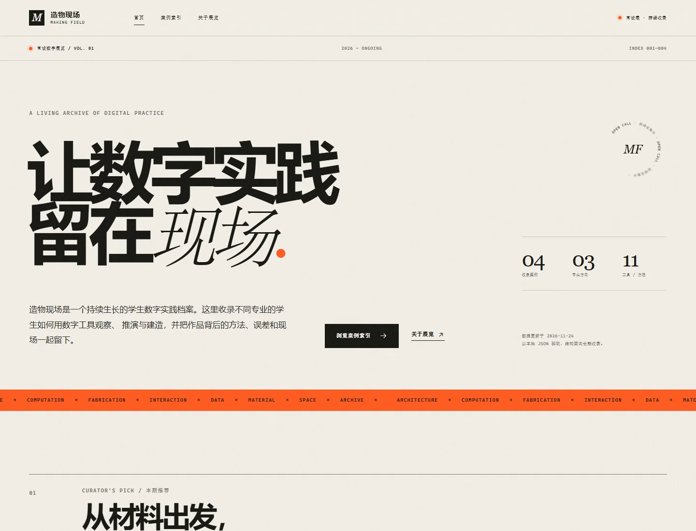
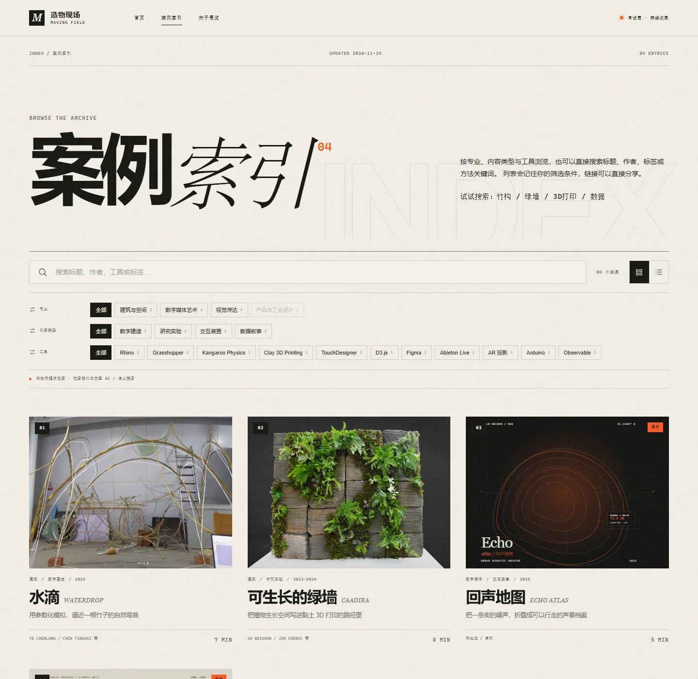
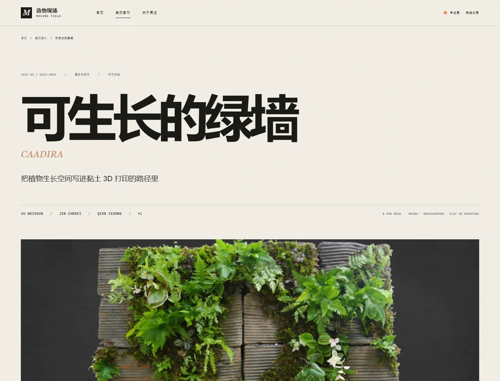
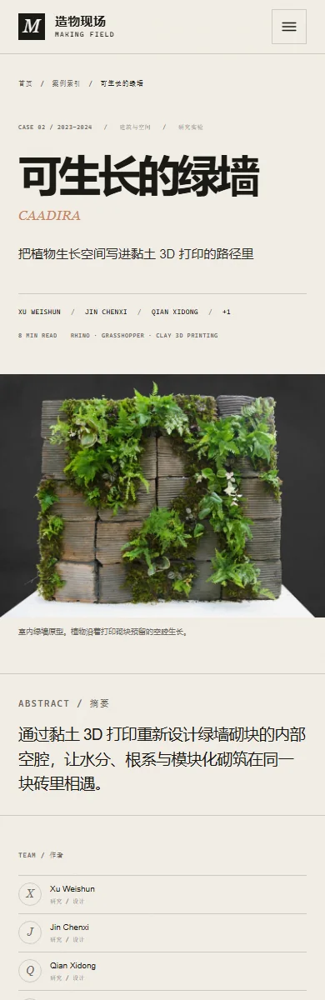

# 造物现场 · 常设数字展览

一个面向长期收录的学生数字实践展览原型。它把不同专业的课程作业、研究实验与实体建造整理成可持续扩展的案例档案，同时保留作品背后的方法、误差与现场。

当前版本基于 **Vite + React + TypeScript + React Router + 本地 JSON**，无后端依赖，适合直接部署为静态站点，也方便后续接入数据库、内容导入器与 AI 搜索。



## 已实现

- **首页**：项目介绍、策展推荐、按专业进入、更多收录、展览方法与说明。
- **案例列表**：案例卡片、网格 / 列表视图、按专业 / 内容类型 / 工具筛选、关键词搜索、筛选条件同步 URL。
- **案例详情**：标题、作者、专业、摘要、分章节正文、过程图片、图像档案、标签、上下篇导航、复制链接。
- **响应式**：适配 1440px 桌面、平板与 390px 手机；移动端提供全屏导航菜单。
- **本地数据**：4 个案例，其中 2 个来自提供的 PDF，2 个为标注清楚的演示数据。
- **工程扩展**：类型定义、数据仓储层、检索提供方、内容校验脚本、内容模型文档。

## 页面预览

| 案例索引 | 案例详情 |
| --- | --- |
|  |  |

<p align="center">
  
</p>

## 技术栈

| 层级 | 选择 | 说明 |
| --- | --- | --- |
| 构建 | Vite 5 | 启动快、配置少 |
| UI | React 18 + TypeScript | 组件化、类型安全 |
| 路由 | React Router 6 | 首页 / 列表 / 详情 / 404 |
| 样式 | 原生 CSS | 无 UI 框架依赖，方便直接修改 |
| 数据 | `src/data/cases.json` | 后续可替换为 API / DB / CMS |
| 校验 | Node 脚本 | 检查字段、ID、枚举与图片路径 |

## 快速开始

环境要求：**Node.js 20+**，推荐使用 Node.js 20 LTS（项目已提供 `.nvmrc`）。

推荐使用 pnpm：

```bash
pnpm install
pnpm dev
```

打开终端提示的地址，默认是 <http://127.0.0.1:5173>。

需要手机真机预览时，可以让开发服务器监听局域网：

```bash
pnpm dev --host
```

然后使用手机访问终端显示的 Network 地址。

也可以使用 npm：

```bash
npm install
npm run dev
```

### 构建与预览

```bash
pnpm build
pnpm preview
```

或：

```bash
npm run build
npm run preview
```

### 检查内容与类型

```bash
pnpm check
```

该命令会执行 TypeScript 检查，并校验：

- 案例 ID / slug 是否唯一；
- 专业与内容类型是否为合法枚举；
- 必填字段、作者、工具、标签是否完整；
- 所有图片引用是否真实存在于 `public/`；
- 内容区块类型是否合法。

单独运行内容校验：

```bash
pnpm validate:content
```

## 交付与部署

项目已提供 Netlify、Vercel 和 Nginx 的 SPA 回退配置：

- `netlify.toml`：Netlify 构建与路由；
- `vercel.json`：Vercel 构建与 rewrites；
- `public/_redirects`：Netlify / Cloudflare Pages 的 SPA fallback；
- `docs/deployment.md`：从打包、上传、绑定域名到权限移交的完整步骤。

最快的公开链接方式：

```bash
pnpm install --frozen-lockfile
pnpm check
pnpm build
```

把 `dist` **里面的内容**压缩成 zip，拖到 <https://app.netlify.com/drop>，得到地址后重点测试 `/cases/waterdrop-bamboo` 的直接访问与刷新。

长期维护建议使用 GitHub + Netlify 自动部署。完整清单见 [交付与部署手册](docs/deployment.md)。

## 页面路由

| 路由 | 页面 |
| --- | --- |
| `/` | 首页 |
| `/cases` | 案例索引，支持 `profession`、`contentType`、`tool`、`q` 查询参数 |
| `/cases/:slug` | 案例详情 |
| `*` | 404 |

筛选状态会写入 URL，例如：

```text
/cases?profession=architecture
/cases?contentType=research
/cases?tool=TouchDesigner
/cases?q=绿墙
```

因此筛选结果可以直接复制分享，也方便未来服务端渲染或搜索页接管。

## 目录结构

```text
.
├─ docs/
│  ├─ content-model.md          # 字段、扩展点、数据库与 AI 接入建议
│  ├─ deployment.md             # 交付、部署、域名与验收步骤
│  └─ screenshots/              # README 截图
├─ public/
│  ├─ _redirects                # Netlify / Cloudflare SPA fallback
│  ├─ favicon.svg
│  └─ media/cases/              # 按 slug 组织的案例图片
├─ scripts/
│  └─ validate-content.mjs      # 内容与图片路径校验
├─ src/
│  ├─ components/               # 导航、页脚、卡片、筛选器、状态组件
│  ├─ data/
│  │  ├─ cases.json             # 案例内容
│  │  └─ taxonomy.ts            # 专业、内容类型、工具字典
│  ├─ hooks/                    # 数据加载、标题、阅读进度、复制链接
│  ├─ pages/                    # 首页、列表、详情、404
│  ├─ services/
│  │  ├─ caseRepository.ts      # 数据访问层（可替换）
│  │  ├─ caseFilters.ts         # 筛选与 facet 计数
│  │  └─ search.ts              # 检索接口 + 本地关键词实现
│  ├─ styles/global.css
│  ├─ types/case.ts             # 统一案例模型
│  ├─ App.tsx
│  └─ main.tsx
├─ index.html
├─ netlify.toml                 # Netlify 部署配置
├─ vercel.json                  # Vercel 部署配置
├─ package.json
└─ vite.config.ts
```

更详细的字段说明和扩展方案见 [docs/content-model.md](docs/content-model.md)。

## 添加一个案例

1. 在 `public/media/cases/` 下新建以 slug 命名的目录，放入封面与过程图片。建议转为 WebP，长边不超过 1800px。
2. 在 `src/data/cases.json` 的 `cases` 数组中复制一个对象，修改 `id`、`slug` 与内容。`cover`、正文 `image`、`gallery` 都引用 `/media/cases/...` 路径。
3. 运行 `pnpm validate:content`，确认没有字段或图片缺失。
4. 运行 `pnpm dev` 查看页面。列表筛选与首页统计会根据新数据自动更新。

建议图片命名：

```text
public/media/cases/your-slug/
├─ cover.webp
├─ process-01.webp
└─ detail-01.webp
```

> 图片必须有 `alt`。用于详情页的图片建议同时提供 `caption`，说明拍摄内容或制作阶段。

## 演示数据说明

- `waterdrop-bamboo` 与 `caadira-green-wall` 的内容、作者与图片来自提供的两份 PDF。
- `echo-atlas` 与 `paper-climate` 标注为“演示”，用于展示非建筑专业、筛选、画廊与不同内容类型。替换这两个对象即可上线正式内容。
- PDF 中的作品版权归原作者所有。用于公开展览前，请确认作者授权与指导教师要求。

## 后续扩展方向

### 1. 替换数据库

`src/services/caseRepository.ts` 暴露 `CaseRepository` 接口。页面只依赖 `listCases()` 与 `getCaseBySlug()`，将实现替换为后端 API 即可：

```ts
export const apiCaseRepository: CaseRepository = {
  async listCases() {
    return fetch('/api/cases').then((response) => response.json());
  },
  async getCaseBySlug(slug) {
    return fetch(`/api/cases/${slug}`).then((response) => response.json());
  },
};
```

建议的数据库结构、迁移路径与字段映射见 [docs/content-model.md](docs/content-model.md)。

### 2. 接入内容导入器

推荐流程：

```text
表单 / CSV / Notion / 飞书表格
        ↓
字段规范化 + slug 生成
        ↓
图片压缩与上传
        ↓
validate-content 同等规则校验
        ↓
写入数据库或生成 cases.json
```

`ContentBlock` 已把正文拆成 `heading / paragraph / image / quote / list` 五种区块，导入器不需要解析自由 HTML。

### 3. 接入 AI 搜索

检索入口在 `src/services/search.ts`：

```ts
export interface CaseSearchProvider {
  id: string;
  label: string;
  search(cases: CaseStudy[], query: string): CaseStudy[];
}
```

当前实现是带权重的本地关键词检索。未来可以：

- 新增 `semanticSearchProvider`，调用后端向量检索；
- 将标题、摘要、标签、工具、正文拼成 `search_text`，离线生成 embedding；
- 保留专业 / 工具 / 内容类型等确定性筛选，把语义检索用于 `q`；
- 在结果为空或无 API 时回退到 `localKeywordSearchProvider`。

页面层只调用 `searchCases()`，替换检索实现无需改页面。

## 验证情况

- `tsc` 类型检查通过；
- 内容校验脚本通过（4 个案例、16 处图片引用）；
- `vite build` 生产构建通过；
- 无头浏览器交互检查 23 项通过：专业 / 内容类型 / 工具筛选、关键词搜索、URL 同步、清空筛选、详情页、图片加载、404、移动端菜单、390px 无横向溢出。

## 已知边界

- 当前为纯前端原型，无登录、后台编辑与持久化；
- 本地检索是关键词匹配，不是真正的语义 / AI 检索；
- 每组筛选为单选，后续如需多选可把查询参数改为逗号分隔数组；
- 详情页图片直接来自 PDF，部分原图分辨率有限；
- 静态部署时需要在服务器配置 SPA fallback，把未知路径回退到 `index.html`（Vite 开发服务器和 `vite preview` 已自动处理）。

## 设计说明

视觉方向是“持续生长的编辑型档案”：暖纸色、墨黑、橙红作为唯一强调色；大字号中文标题、等宽索引号、细分隔线与大量留白构成展览的秩序感。动效只用于提示状态和进入节奏，并尊重 `prefers-reduced-motion`。

---

原型版本 v0.1 · 2026
